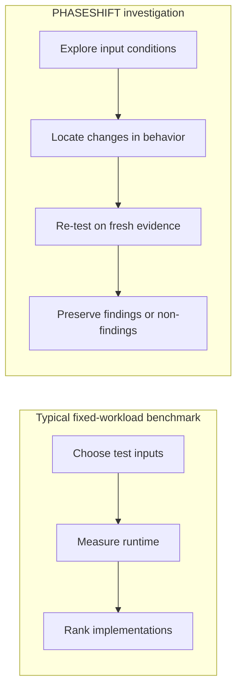
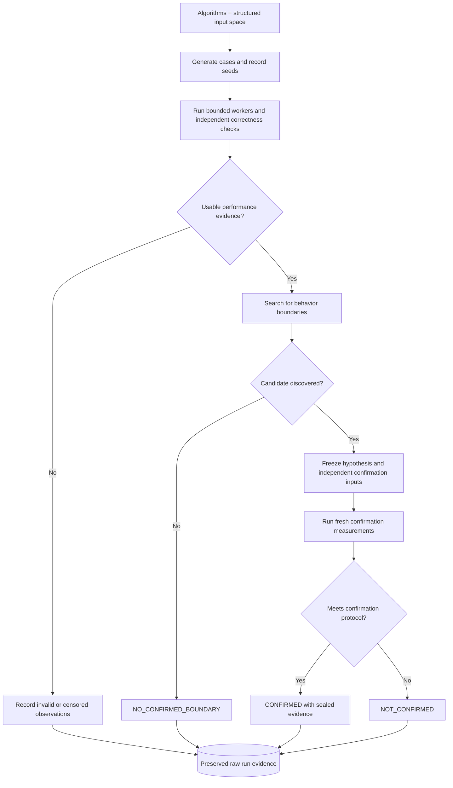
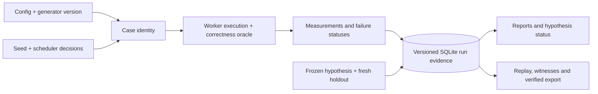

# PHASESHIFT

**Discover where an algorithm changes behavior — and preserve the evidence needed to verify it.**

PHASESHIFT is an **offline, CPU-only C++20 research engine for algorithmic behavior boundaries**. It systematically varies inputs, measures real implementations, searches for significant changes, independently tests candidate findings, and preserves reproducible evidence.

It is **not just another benchmark**. The central question is not simply *“Which algorithm is faster?”* It is:

> **Under which specific input conditions does an algorithm become slower, faster, incorrect, or resource-intensive — and can we reproduce that change?**

A boundary can be a performance cliff, a crossover between implementations, a correctness failure, or a resource limit. PHASESHIFT is designed to investigate these boundaries rather than assume that a smooth average benchmark represents every input regime.

## Why this exists

Most benchmarks answer a narrow question: how long did an implementation take on a chosen set of inputs? They are useful, but a single average can conceal the **shape of an algorithm's behavior**.

### A benchmark versus a boundary investigation



*Conceptual comparison — not a measured performance result. Both approaches are useful; PHASESHIFT focuses on finding the conditions under which behavior changes.*

For example, consider two sorting implementations:

| Input regime | Algorithm A | Algorithm B | What matters |
|---|---|---|---|
| Small, randomly distributed arrays | Faster | Slower | A is preferable here |
| Larger, randomly distributed arrays | Similar | Similar | No decisive difference yet |
| Larger, nearly sorted arrays | Much slower | Faster | A possible structural performance cliff |
| Large arrays with many duplicate values | Depends on implementation | Depends on implementation | Investigate a different structural regime |

*This table is illustrative, not measured PHASESHIFT output.*

A conventional benchmark may report that B wins overall. PHASESHIFT aims to answer the deeper questions:

- **Where?** At what input sizes or structural conditions does behavior change?
- **What kind of change?** An abrupt cliff, a gradual trend, a crossover, a wrong answer, or a timeout?
- **Under which conditions?** Does the change depend on input distribution, duplicates, graph connectivity, or another parameter?
- **Is it real?** Does it survive fresh seeds, independent oracle checks, and a predeclared confirmation procedure?
- **Can someone else inspect it?** Can we preserve the original measurements, decision transcript, input identity, and a minimal reproducer when supported?

The goal is **evidence-backed algorithmic discovery** — finding interesting behavior that developers might otherwise miss, including *negative findings* where a suspected boundary does not hold.

## What PHASESHIFT actually does



*The diagram is conceptual. Exact hypothesis states, eligibility, and confirmation checks follow the supported versioned experimental protocol.*

A successful run **does not have to find a boundary**. Rejecting a candidate or reporting no confirmed boundary is a legitimate research result, not a failure of the engine.

### A concrete built-in example

The `calibration` family has a synthetic threshold fixture whose expected transition is known by construction. This exercises the discovery and confirmation pipeline without presenting synthetic operation counts as real-world performance.

```bash
# Build first (commands in the next section).
./build/phaseshift demo --out runs/first_demo
./build/phaseshift report --run runs/first_demo --format markdown,json,csv,html
```

You can also run a **real algorithm comparison**:

```bash
./build/phaseshift validate --config configs/sorting_quicksort.json
./build/phaseshift explore --config configs/sorting_quicksort.json --out runs/sorting_study
./build/phaseshift report --run runs/sorting_study --format markdown,json,csv,html
```

The sorting example explores input sizes and distributions while comparing `std_sort` with a first-pivot quicksort implementation. It may or may not produce a confirmed finding on your system. The report and SQLite data provide the evidence; **do not interpret an exploratory score as an independently confirmed result**.

## What is it useful for?

| Use case | Question PHASESHIFT can investigate | Current scope |
|---|---|---|
| **Sorting implementations** | Where does input size or distribution change the performance ranking? | Built in |
| **Top-K selection** | When does a heap, full sort, or selection-based approach become advantageous? | Built in |
| **Graph / shortest-path algorithms** | Which graph densities, weights, or connectivity regimes change behavior? | Built in |
| **Correctness and resource boundaries** | Which inputs trigger wrong answers, crashes, timeouts, or excessive memory? | Status-aware workers and evidence; supported cases vary |
| **Custom native algorithms** | Does a proprietary implementation have a reproducible pathological input? | Trusted native-plugin interface currently supports the integer-array contract |
| **CUDA kernels or MEV route searches** | Where do specialized kernels or search/pruning strategies cease to scale well? | **Potential future integration**, not a built-in CUDA/MEV engine |

These results can help developers choose implementation strategies, target optimizations, build regression tests, and understand unexplained changes in performance. **PHASESHIFT investigates; it does not automatically rewrite or optimize algorithms.**

## What makes it different from a simple benchmark?

PHASESHIFT combines **structured input-space exploration**, independent correctness checks, measurements from actual workers, boundary-search policies, **fresh-sample confirmation**, and evidence persistence. It keeps failed measurements rather than treating an invalid answer, crash, or timeout as a performance win.

Each run can retain its configuration, environment information, generator identity, candidate decisions, raw observations, hypothesis status, confirmation evidence, and replay/witness material. This makes the output **auditable and falsifiable**, not merely a table of timings.

### From observation to reproducible evidence



*Confirmation requires appropriate fresh holdout evidence and a valid seal; merely storing a hypothesis does not make it confirmed.*

### Scientific limits

PHASESHIFT must **not** be described as:

- a general mathematical theorem prover or a proof of asymptotic Big-O complexity;
- a system that establishes causality from observational performance patterns alone;
- an automatic optimizer or universal fastest-algorithm selector;
- a guarantee that a significant-looking candidate is true without independent confirmation;
- a proven state-of-the-art (SOTA) search engine solely because its code or CI passes.

Confirmation is tied to the supported statistical protocol and explicit provenance. Hardware noise, finite input ranges, selection bias, resource budgets, and differences between benchmark contracts still matter.

## Project status

- **`main`** contains the working v1 research engine and an **experimental v2 core**, including additional search policies. The v1 behavior remains the compatibility baseline.
- **Further v2 development** is tracked in [draft PR #5](https://github.com/SaridakisStamatisChristos/PhaseShift/pull/5). Work on that branch is **not yet merged into `main`**.
- GitHub CI exercises GCC, Clang, sanitizers, and production-line coverage. Passing tests demonstrate implementation quality; they do **not** establish superiority over external search methods.
- For implementation contracts and limitations, see [the full specification](docs/PHASESHIFT_SPEC.md), [v2 research documentation](docs/v2/), and the [PR #5 review](https://github.com/SaridakisStamatisChristos/PhaseShift/pull/5).

The long-term ambition is an **autonomous experimental laboratory for algorithms**: given implementations and a well-defined input space, systematically uncover important behavioral regimes and preserve the evidence to challenge or confirm each finding.

## Build on Linux

Install CMake >=3.24, Ninja (recommended), GCC >=12 or Clang >=16, C/C++20 headers, SQLite3 development libraries, OpenSSL Crypto development libraries, `json-c` and `pkg-config` (Ubuntu: `cmake ninja-build g++ clang libsqlite3-dev libjson-c-dev libssl-dev pkg-config`). No GPU, Python interpreter, paid API, hosted model or Internet connection is required to execute experiments after dependencies have been installed.

```bash
cmake -S . -B build -G Ninja -DCMAKE_BUILD_TYPE=Release
cmake --build build -j2
ctest --test-dir build --output-on-failure
./build/phaseshift doctor
./build/phaseshift demo --out runs/first_demo
```

Or use `cmake --preset portable-release`, `cmake --build --preset portable-release`, `ctest --preset portable-release`; other presets cover Clang and ASan/UBSan. No implicit `-march=native` is enabled. Run `bash scripts/acceptance_smoke.sh` to execute the natural command-line acceptance protocol; it needs `jq` only for shell-level assertions and writes a new preserved directory under `runs/`.

## Built-in algorithms and inputs

| Family | Oracle | Tested algorithms |
|---|---|---|
| `integer_array` | independent stable ascending sort | `std_sort`, `mergesort`, `insertion_sort` (`n<=4096`), vulnerable first-pivot quicksort (`n<=20000`) |
| `topk` | descending full sort, duplicate-retaining | `topk_full_sort`, `topk_heap`, `topk_nth` |
| `graph` | Bellman-Ford, with independent Floyd–Warshall tiny-graph tests | heap / dense Dijkstra, `zero_one_bfs` only on 0–1 weighted graphs |
| `calibration` | exact instrumented operation-count formula | synthetic threshold and deterministic no-change control |

Array morphology includes uniform, ascending, descending, nearly-sorted, organ-pipe, sawtooth, alternating, all-equal, heavy-duplicate, few-unique, and Zipf-like deterministic distributions. The versioned generator supports value range, sign/duplicate/disorder fractions and run lengths. Graph parameters include directed/undirected edges, density, degree skew, communities, connectivity, source and weight classes. Generator v1 stays replay-compatible; v2 adds typed morphology; v3 is an exact literal-byte witness representation for schema-aware array/Top-K/directed-and-undirected-graph minimization.

A native trusted plugin can implement the versioned C ABI in [`include/phaseshift/plugin.h`](include/phaseshift/plugin.h); v1 plugins support the integer-array contract only. Plugins execute in a bounded child worker, not in the parent process, but **native plugin execution is not a complete security sandbox**. Malformed plugin ABI, wrong answers, exceptions, crashes, timeouts and memory failures are isolated and recorded as such, not included in valid timing rankings.

## CLI commands

```bash
./build/phaseshift --help
./build/phaseshift --version
./build/phaseshift list families
./build/phaseshift list algorithms
./build/phaseshift validate --config configs/sorting_quicksort.json
./build/phaseshift demo --out runs/demo_001
./build/phaseshift explore --config configs/sorting_quicksort.json --out runs/sort_001
./build/phaseshift resume --run runs/sort_001
./build/phaseshift confirm --run runs/sort_001 --hypothesis H1
./build/phaseshift minimize --run runs/demo_001 --hypothesis H1
./build/phaseshift reproduce --run runs/sort_001 --case CASE_ID --algorithm std_sort --out witness.cpp
./build/phaseshift replay --run runs/demo_001 --case CASE_ID --db runs/demo_001/run.sqlite
./build/phaseshift report --run runs/demo_001 --format markdown,json,csv,html
./build/phaseshift scaling --run runs/sort_001 --out runs/sort_scaling --seeds 3
./build/phaseshift ablate --config configs/adaptive_sparse.json --out runs/search_ablation
./build/phaseshift export --run runs/demo_001 --out runs/demo_bundle
./build/phaseshift verify-bundle --bundle runs/demo_bundle
./build/phaseshift import --bundle runs/demo_bundle --out runs/imported_demo
./build/phaseshift compare --a runs/sort_001 --b runs/sort_002
```

`reproduce` exports a self-contained, standard-library-only C++20 witness for built-in algorithms and embeds a frozen independent oracle answer. Generated programs are compiled and executed in CTest. Single-sample printed timings are not confirmed performance findings. Embedded inputs are capped at 2 MiB; larger cases require the verified input + runner evidence bundle. Native plugins cannot be converted to source because their code is not owned by this project.

`resume` resumes an unfinished experiment by replaying the transactional scheduler decision log; complete runs cannot be silently overwritten. `confirm` requires a frozen, detected candidate; **it is expected to reject the command for an experiment that reports `NO_CONFIRMED_BOUNDARY`**. `minimize-case --run RUN --case CASE_ID --algorithm plugin:/absolute/path.so` separately shrinks an oracle-confirmed wrong answer. `replay ... --expect wrong_answer --algorithm plugin:...` verifies expected incorrect plugin behavior. The `compare` command rejects incompatible algorithm contracts and warns about hardware equivalence; it is not a causal performance comparison.

## What is and is not confirmed

The known synthetic fixture crosses its engineered threshold from `x=7` to `x=8` (for `threshold=8`). Its `SYNTHETIC_CALIBRATION` result is confirmed with independent cases and a byte-replayable witness. The constant-work negative control must return `NO_CONFIRMED_BOUNDARY`.

For real algorithms the engine records balanced ABBA / BAAB execution order, per-operation wall and CPU timing, peak memory and failure outcomes. Search methods include grid, uniform random, stratified and feedback-adaptive numeric-axis selection; each has a deterministic, budgeted schedule. A single selected and **frozen** performance candidate can be independently checked using new case seeds, case-paired bootstrap confidence intervals (99% default), a sign-flip randomization test and declared BH-FDR policy. The practical-effect ratio, confidence and FDR q are configurable. A failed confirmation remains `NOT_CONFIRMED`; a noisy performance witness becomes provisional, not silently promoted. Categorical structural axes can be conditioned on, but are **not falsely interpreted as ordered numeric axes**.

Operation-count calibration is not real performance; fitted scaling functions are empirical over finite sizes, not Big-O proofs; observational boundaries alone are not causal. Performance rankings never consider wrong-answer, crash or timeout samples valid.

## Evidence and reproducibility

Each run contains a versioned SQLite database with raw measurement rows, environment and algorithm records, scheduler transcript, generator identity, hypotheses, confirmations, witnesses and events. `report.json`, `report.md`, `samples.csv` and `report.html` are static local projections. `phaseshift export` hashes an immutable bundle and verifies its input bytes, manifest and database; `verify-bundle` rejects tampering, and `import` refuses to overwrite an existing destination. Original raw evidence is never overwritten by replay. Normal generated runs and builds are Git-ignored.

The benchmark/host provenance, significance limitations, acceptance test matrix, safety constraints and prior-art comparisons are described in `docs/`.

## Licensing

Native v1 plugin artifacts receive a SHA-256 binary identity in the algorithm evidence registry when the plugin file is available. A changed native binary under the same path is rejected rather than silently mixed into the run. External plugin build flags are not recoverable from this ABI; no metadata is fabricated.

No project license has been selected; the repository owner retains applicable rights. System dependencies have their own licenses. Do not redistribute PHASESHIFT under an invented license.

## R7 v1.0 contract hardening

The original v1.0 specification has an explicit requirement-to-evidence map in [`docs/v1_requirements_evidence.md`](docs/v1_requirements_evidence.md). In addition to the original functionality, current source provides configurable adaptive exploration fraction and measured batch floor, a fresh-worker-per-sample option, detailed host/build provenance comparison, irreversible experiment evidence state transitions, empirical scaling-regime detection with new-size holdout confirmation, and matched-seed structural interventions. These features are intentionally conservative and may abstain.

Config excerpts (both configuration forms persist into the immutable run manifest):

```json
{
  "search": {"method": "adaptive_partition", "exploration_fraction": 0.20},
  "measurement": {"minimum_batch_ms": 2, "isolation_mode": "per_case"}
}
```

`isolation_mode: "per_sample"` starts one child process per timed operation and preserves paired blocks/order metadata. It is slower and measures a different cache/plugin-state regime than `per_case`; compare results only after documenting this difference. `minimum_batch_ms` has a 1–100 ms range, and the adaptive exploration fraction must be between zero and one inclusive. The scheduler's quota is deterministic, including after resume.

Use `phaseshift scaling --run RUN --out NEW_RUN --seeds 3` for empirical scaling fits. If a predeclared single-algorithm segmented candidate is identified, PHASESHIFT can check it on **new sizes and independent seeds**, applying the configured confidence and practical slope-change threshold. A model fit alone is never upgraded to a confirmed finding. Use `phaseshift intervene --run RUN --out NEW_RUN --hypothesis H1 --pairs 20` to measure matched-seed neighbor cases and enumerate observed morphology changes. This is an *intervention diagnostic*, **not a causal-identification proof**.

`phaseshift compare --a RUN --b RUN` evaluates recorded host/build metadata and emits explicit compatibility states. The code or library revision, compiler flags, CPU model/affinity/governor, and platform can differ even when two configurations name the same algorithm. Matching metadata cannot prove thermal, noise or hardware equivalence. Do not embed secrets into compiler flags intended for public evidence reports.

## Post-audit scientific evidence integrity (SQLite schema 7)

Independent R7 audit findings F-001–F-009 are tracked in [`docs/r7_audit_repair_2026-11-20.md`](docs/r7_audit_repair_2026-11-20.md). SQLite v7 now requires a `TESTED` hypothesis and a sealed, SQL-linked independent holdout cohort before `CONFIRMED`; the audit can inspect actual CaseIds and SampleIds. A legacy v6 `CONFIRMED` row without a v7 seal is retained in raw storage but projected in reports as `UNVERIFIED_LEGACY_CONFIRMATION`, not independently attested. Scaling discovery and holdout populations are distinct, and the report publishes the actual new-size set. Unknown/duplicate CLI options are rejected; replay's `--db` selects and verifies the supplied existing SQLite database instead of being ignored. Unsupported primary metrics and native plugin-family combinations fail validation.

The B07 real 0–1 graph comparison, deterministic B10/B11 synthetic research controls and B02 null-ablation scorecard are included in CTest. Per-method ablation reports discovery yield and null false positives when the ground truth is known; witness byte reduction is reported only if minimization actually ran, otherwise `NA`. Simulator successes are not physical CPU findings. The full 31-test GitHub-hosted acceptance suite was executed on commit `6e343b8f1efe` under GCC, Clang and ASan/UBSan, including all three CLI smoke tests.
